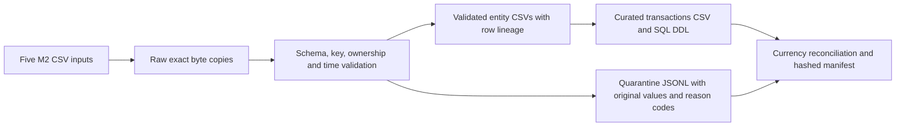

# Financial data foundation v1

## Decision and boundaries

The foundation is an additive local batch workflow, version `1.0.0`, with an explicit adapter for M2 `2.0.0`. It imports the five closed M2 observation schemas rather than introducing competing entity definitions. It does not consume outcomes or the evaluation export. These may coexist in an M2 directory but are not financial source tables. The inherited CLI, M1 evaluator, M2 generator and historical samples keep their separate interfaces. There are no cloud connectors or deployed resources.

A batch is a complete, independent snapshot, not an incremental upsert. No prior batch state is consulted. Accepted primary keys must be unique within the snapshot; every occurrence of a duplicate key is quarantined, with dependent rows rejected if their parent is unavailable. Cross-batch deduplication, corrections, CDC, slowly changing dimensions and account lifecycle changes are deferred.

## Canonical relationships and time

| Entity | Primary key | Parent relationship | Event/availability field |
| --- | --- | --- | --- |
| customer | customer_id | none | onboarded_at |
| account | account_id | customer_id → customer | opened_at |
| beneficiary | beneficiary_id | account_id → account | first_seen_at |
| device | device_id | customer_id → customer | first_seen_at |
| transaction | transaction_id | customer_id, account_id, beneficiary_id, device_id | transaction_timestamp |

Transactions must use an account and device owned by their customer, and a beneficiary registered to their account. Each child event must be at or after its parent's availability timestamp. Transaction country fields must agree with the referenced device and beneficiary observations. All entity/event times must be at or before `source_time`.

`source_time` is the caller-declared upstream snapshot availability time. `ingestion_time` is the caller-declared receipt time, enabling historical replay; it must be at or after source time. Neither metadata field is inferred from file modification times or independently authenticated. Actual processing start and finish times are separately recorded in the manifest. All declared timestamps use the M2 UTC whole-second `Z` format. There is no wall-clock cutoff or label-availability inference. This is a snapshot contract, not a bitemporal event store.

## Validation, stages and reconciliation



Required source filenames are `customers.csv`, `accounts.csv`, `beneficiaries.csv`, `devices.csv`, and `transactions.csv`. Each CSV has exactly its M2 columns, all required, with no coercive repairs. Column order may vary; output order is canonical. Extra source files are not ingested. Extra columns (including labels) invalidate the table header. Record ordinals exclude the header and count CSV records rather than physical lines. Wrong row widths, invalid schema values, duplicate keys, unavailable parents, incompatible ownership, chronology violations and inconsistent monetary/country fields produce deterministic per-record reasons. Parent rejection propagates to children; validation may stop further checks once prerequisites fail.

All raw bytes are retained under `raw/`; accepted entity records are written under `validated/`. Quarantine retains original values, parsed fields, source record ordinal, file hash, source ID and reason codes. Invalid UTF-8 or unparseable CSV prevents reliable row boundaries and fails the batch with an error in the manifest while preserving raw inputs. Missing/unreadable input files and invalid invocation metadata are rejected before a run begins. Consumers must require a completed manifest status before using any product; failed runs can contain partial artifacts. `completed_with_rejects` is an explicit successful partial acceptance, not evidence that every source row was valid. It exits zero; inspect reconciliation and quarantine before adopting the batch. There is no reject-rate promotion gate in v1.

Money uses positive canonical integer `amount_minor` with a supported currency exponent and matching decimal-string `amount`. Account and transaction currency must agree. The pipeline computes only currency-keyed totals. Cross-currency totals have no defined monetary meaning and are prohibited without an explicit conversion contract; no conversion is implemented. The raw SQL product still permits arbitrary consumer queries, so downstream consumers must retain currency in grouping keys. Integer totals use Python integers; unknown currency or malformed minor amounts are counted as unaccountable, never assigned zero or invented monetary value.

For every table, source rows = validated rows + quarantined rows. For transactions, source accountable minor-unit totals = validated totals + rejected totals per currency, and unaccountable row counts reconcile separately. Curated row counts and value totals must exactly equal validated transactions. Failed reconciliation fails the run. These partition checks do not imply a ledger balance or economic correctness.

## Run provenance and repeatability

```bash
python3 -m financial_crime_ml.cli generate-data-v2 --run-id foundation-source
python3 -m financial_crime_ml.cli ingest-financial-data \
  --dataset-dir outputs/runs/foundation-source \
  --source-id synthetic-v2 \
  --source-time 2026-01-01T00:00:00Z \
  --ingestion-time 2026-01-02T00:00:00Z \
  --run-id foundation-load
```

Runs live in ignored `outputs/runs/<run-id>/`. The manifest records source path, source and receipt metadata, exact input hashes, contract, Git revision and dirty state, all source hashes, dependency versions and output artifact hashes. Every validated/curated row carries `source_id`, `source_time`, `ingestion_time`, `source_row` and `source_sha256`, tracing it to raw bytes. The curated customer country is joined through its customer key into the same run's validated customer table. Rejects are traceable to the same raw snapshot.

A signature binds input content, declared metadata, foundation version and implementation fingerprint. Reusing a run ID with the same signature verifies all artifact hashes and returns the original run without rewriting files. Changed inputs/settings/source or a failed prior run require a new run ID. Tampering with artifacts fails reuse. Separate run IDs with identical inputs/metadata/source yield identical payloads; manifests contain actual execution timestamps and run IDs. This is single-process idempotence, not a concurrent transaction protocol. Hashes detect changes, not malicious replacement of both content and its manifest. Run directories are not access-control boundaries. Historical sample destinations are protected; the Python API supports temporary output roots for tests.

## SQL product and future BigQuery mapping

`curated/transactions.csv` has the M2 transaction observations, a joined `customer_country`, and five lineage fields. It intentionally has no outcome labels. `curated/schema.sql` provides a portable SQLite-compatible DDL with a transaction primary key, integer minor units/source row and text observations. Local tests execute the DDL and independently reconcile SQL `GROUP BY currency` sums. M1 continues to consume the separate M2 `evaluation_transactions.csv` export, since its target is not part of this observation product.

Future BigQuery mapping (design only): IDs, categories, country, currency and source hashes → STRING; `amount_minor` and `source_row` → INT64; event/source/ingestion times → TIMESTAMP; canonical decimal `amount` → STRING for lossless interchange (derive NUMERIC using the explicit currency exponent if needed). Partition by transaction event date and consider account/customer clustering. BigQuery key declarations would not replace ingestion integrity checks. Currency must remain in all monetary aggregation keys. No dataset, IAM, load job, billing setup or BigQuery connector has been implemented or executed.

## Limits and security/cost

This remains a fictional M2 adapter with synthetic identifiers, restricted enums and a fixed currency exponent map. It does not establish real banking source conformance, real fraud validity, FX, a financial ledger or production throughput. Each source is loaded in memory. Raw plus validated plus curated copies increase local disk use; quarantine may contain sensitive values if real data is supplied. Retention, encryption, PII minimization, access controls and signed provenance would require a separate production design. There are no external dependencies added, network calls, cloud costs or deployed capabilities in this milestone.

Executed results: [M3 validation record](upgrade/m3_validation.md).
